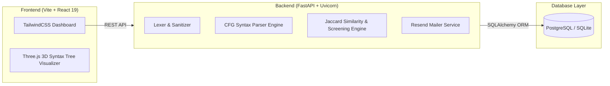

# SyntaxHire: CFG-Powered Intelligent Resume Parser & ATS

> **Theory of Computation (TOC) & Compiler Design Capstone Project**  
> An automated applicant tracking and resume screening system powered by Context-Free Grammar (CFG) parsing, 3D parse tree visual dynamics, semantic skill matching, and automated email dispatch.

---

## 🌟 Project Overview

**SyntaxHire** is an end-to-end recruitment platform that applies formal language theory and compiler design principles (Lexical, Syntactic, and Semantic Analysis) to parse and screen unstructured PDF resumes into structured candidate intelligence.

### Key Capabilities
- **Lexical Analysis (Tokenizer)**: Recognizes terminals such as `EMAIL`, `PHONE`, `DATE_RANGE`, and section header delimiters (`EXPERIENCE`, `EDUCATION`, `SKILLS`).
- **Context-Free Grammar (CFG) Parser**: Implements recursive descent grammar production rules (`S -> Header Experience Education Skills`) to extract structured candidate entities.
- **Interactive 3D Syntax Tree Visualizer**: Utilizes Three.js to render real-time 3D parse-tree animations depicting CFG token reductions during resume ingestion.
- **Automated Candidate Screening**: Computes real-time match scores against job postings using Jaccard skill similarity, experience duration, and education level multipliers.
- **Automated Candidate Email Dispatch**: Sends status notifications (e.g. shortlisting updates, constructive missing-skill feedback) via the Resend API.
- **Recruiter Admin Dashboard**: Manage job requisitions, evaluate applicant pools, inspect detailed score rationales, and update hiring statuses.

---

## 🛠️ Architecture & Tech Stack



- **Frontend**: React 19, Vite, TailwindCSS v4, Three.js, React Router v7
- **Backend**: FastAPI, Uvicorn, Lark, pdfplumber, SQLAlchemy 2.0, Pydantic v2
- **Database**: SQLite (local development zero-config) / PostgreSQL (production)
- **Deployment**: Vercel (Frontend) + Render / Railway (Backend) + Supabase / Neon (Database)

---

## 🚀 Quickstart: Running Locally

### Prerequisites
- **Node.js** (v18+)
- **Python** (v3.10+)

### Launching the Application

#### Step 1: Start Backend
```powershell
cd backend
python -m uvicorn main:app --reload --host 0.0.0.0 --port 8000
```
Backend API will be running at: `http://localhost:8000`  
Interactive Swagger API documentation: `http://localhost:8000/docs`

#### Step 2: Start Frontend
```powershell
cd frontend
npm run dev
```
Frontend will be running at: `http://localhost:5173`

---

## 🔑 Default Login Credentials

| Role | Username | Password |
|---|---|---|
| **Administrator / Recruiter** | `admin` | `admin` |

*(Account is automatically seeded in the database upon initial backend boot)*

---

## 🌐 Full Cloud Deployment Guide

Follow these simple steps to deploy the complete stack online for free:

### Step 1: Database Setup (Free PostgreSQL)
1. Go to [Supabase](https://supabase.com) or [Neon](https://neon.tech) and create a free project.
2. In Project Settings, navigate to **Database** -> **Connection string** (URI).
3. Copy the URI (format: `postgresql://postgres:[PASSWORD]@[HOST]:[PORT]/postgres`).

### Step 2: Backend Deployment (Render.com)
1. Sign up on [Render.com](https://render.com) and click **New** -> **Web Service**.
2. Connect your GitHub repository (`TOC-capstone-main`).
3. Set the following settings:
   - **Root Directory**: `backend`
   - **Environment**: `Docker` (Render will automatically detect `backend/Dockerfile`)
4. Under **Environment Variables**, add:
   - `DB_URL`: *[Paste your Supabase/Neon PostgreSQL connection URI]*
   - `RESEND_API_KEY`: *[Optional: your Resend API key for automated emails]*
   - `SMTP_EMAIL`: `onboarding@resend.dev`
5. Click **Create Web Service**.
6. Once deployed, copy your service URL (e.g. `https://syntaxhire-api.onrender.com`).

### Step 3: Frontend Deployment (Vercel)
1. Sign up on [Vercel](https://vercel.com) and click **Add New** -> **Project**.
2. Import your GitHub repository.
3. Configure the project:
   - **Root Directory**: Click edit and select `frontend`.
   - **Framework Preset**: `Vite`
   - **Build Command**: `npm run build`
   - **Output Directory**: `dist`
4. Under **Environment Variables**, add:
   - `VITE_API_URL`: *[Paste your deployed Render backend URL, e.g. `https://syntaxhire-api.onrender.com`]*
5. Click **Deploy**.

Your application will now be live on the web!

---

## 📁 Repository Structure

```
.
├── backend/
│   ├── api.py               # FastAPI route handlers & endpoints
│   ├── database.py          # SQLAlchemy engine & session manager
│   ├── db_operations.py     # Database CRUD operations
│   ├── Dockerfile           # Production container configuration
│   ├── email_service.py     # Resend email notification service
│   ├── extractor.py         # PDF text extraction engine
│   ├── main.py              # Application entrypoint
│   ├── models.py            # SQLAlchemy database models
│   ├── parser_engine.py     # Lexer & CFG Recursive Descent Parser
│   └── requirements.txt     # Python dependencies
├── frontend/
│   ├── src/
│   │   ├── components/      # React components (Dashboard, 3D Tree, Jobs, etc.)
│   │   ├── App.jsx          # Route definitions & auth wrapper
│   │   └── main.jsx         # App mounting point
│   ├── package.json         # NPM packages
│   └── vite.config.js       # Vite configuration
└── README.md                # Project documentation
```
