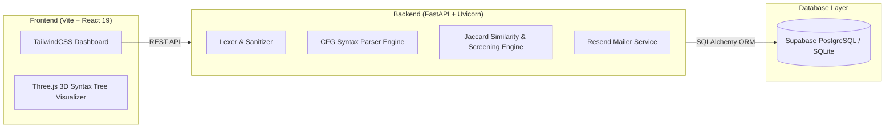

# TOC Parser - Resume Intelligence

> **Theory of Computation (TOC) & Compiler Design Capstone Project**  
> An automated applicant tracking and resume screening system powered by Context-Free Grammar (CFG) parsing, 3D parse tree visual dynamics, semantic skill matching, and automated email dispatch.

[](https://toc-parser-resume-intelligence.onrender.com/docs)
[](https://supabase.com)
[](https://vitejs.dev)

---

## 🌟 Project Overview

**TOC Parser - Resume Intelligence** is an end-to-end recruitment platform that applies formal language theory and compiler design principles (Lexical, Syntactic, and Semantic Analysis) to parse and screen unstructured PDF resumes into structured candidate intelligence.

### Key Capabilities
- **Lexical Analysis (Tokenizer)**: Recognizes terminals such as `EMAIL`, `PHONE`, `DATE_RANGE`, and section header delimiters (`EXPERIENCE`, `EDUCATION`, `SKILLS`).
- **Context-Free Grammar (CFG) Parser**: Implements recursive descent grammar production rules (`S -> Header Experience Education Skills`) to extract structured candidate entities.
- **Interactive 3D Syntax Tree Visualizer**: Utilizes Three.js to render real-time 3D parse-tree animations depicting CFG token reductions during resume ingestion.
- **Automated Candidate Screening**: Computes real-time match scores against job postings using Jaccard skill similarity, experience duration, and education level multipliers.
- **Automated Candidate Email Dispatch**: Sends status notifications (e.g. shortlisting updates, constructive missing-skill feedback) via the Resend API.
- **Recruiter Admin Dashboard**: Manage job requisitions, evaluate applicant pools, inspect detailed score rationales, and update hiring statuses.

---

## 📐 Formal Grammar & Compiler Pipeline (TOC)

The parsing engine follows classical multi-phase compiler architecture:

```
[ Unstructured PDF Resume ]
             │
             ▼
    [ Text Sanitization ]  ─── Normalizes bullets, merges fragmented words
             │
             ▼
    [ Lexical Analyzer ]   ─── Regex tokenization into Terminals
             │
             ▼
       [ CFG Parser ]      ─── Recursive Descent Syntax Analysis
             │
             ▼
    [ Semantic Extractor ] ─── Entity mapping (Experience, Education, Skills)
             │
             ▼
    [ Scoring & Matching ] ─── Jaccard Similarity & Education Heuristics
```

### Context-Free Grammar (CFG) Production Rules:
```bnf
S           -> Header Experience Education Skills
Header      -> Name Email Phone
Experience  -> SECTION_EXPERIENCE ExpItem+
ExpItem     -> JobTitle Company DateRange Description
Education   -> SECTION_EDUCATION EduItem+
EduItem     -> Degree Institution GradYear
Skills      -> SECTION_SKILLS SkillItem+
```

### Screening & Match Scoring Algorithm:
1. **Skill Match (Jaccard Similarity)**:
   $$\text{Skill Score} = \left( \frac{|S_{\text{candidate}} \cap S_{\text{job}}|}{|S_{\text{candidate}} \cup S_{\text{job}}|} \right) \times 100$$
2. **Education Heuristic Multiplier**:
   - Degree matches or exceeds requirement: `1.0x`
   - Master's required, candidate has Bachelor's: `0.5x`
   - PhD required, candidate has Bachelor's: `0.2x`
3. **Final Weighted Score**:
   $$\text{Final Score} = \lfloor \text{Skill Score} \times \text{Education Multiplier} \rfloor$$

---

## 🛠️ Architecture & Tech Stack



- **Frontend**: React 19, Vite, TailwindCSS v4, Three.js, React Router v7
- **Backend**: FastAPI, Uvicorn, Lark, pdfplumber, SQLAlchemy 2.0, Pydantic v2
- **Database**: Supabase PostgreSQL (IPv4 Session Pooler) / SQLite (zero-config local dev)
- **Deployment**: Vercel (Frontend) + Render (Backend) + Supabase (Database)

---

## 🧪 Sample Test Profiles

Four reference test resumes are provided locally in [`sample_resumes/`](./sample_resumes/) for validation:

| Candidate | Role | Degree | Key Skills | Recommended Test Job |
|---|---|---|---|---|
| **Sarah Chen** | Senior Full Stack Engineer | B.Tech, Stanford | Python, FastAPI, React, PostgreSQL, Docker, TailwindCSS | *Full Stack Software Engineer* (Python, React, FastAPI) |
| **David Miller** | Backend Systems Engineer | M.Tech, Georgia Tech | Python, SQLAlchemy, PostgreSQL, Docker, AWS, FastAPI | *Senior Backend Engineer* (Python, PostgreSQL, AWS) |
| **Priya Sharma** | Frontend React Engineer | B.E., UC Berkeley | React, JavaScript, Three.js, TailwindCSS, Vite | *Frontend & UI Engineer* (React, Three.js, TailwindCSS) |
| **Alex Johnson** | Junior Software Engineer | B.Tech, State Poly | Python, JavaScript, React, HTML, CSS, Git | *Junior Web Developer* (JavaScript, Python, HTML) |

---

## 🚀 Quickstart: Running Locally

### Prerequisites
- **Node.js** (v18+)
- **Python** (v3.10+)

### Step 1: Start Backend
```powershell
cd backend
python -m uvicorn main:app --reload --host 0.0.0.0 --port 8000
```
- API server running at: `http://localhost:8000`
- Interactive Swagger API docs: `http://localhost:8000/docs`

### Step 2: Start Frontend
```powershell
cd frontend
npm run dev
```
- Frontend application running at: `http://localhost:5173`

---

## 🔑 Default Login Credentials

| Role | Username | Password |
|---|---|---|
| **Administrator / Recruiter** | `admin` | `admin` |

*(Account is automatically seeded in the database upon initial backend boot)*

---

## 🌐 Cloud Deployment Architecture

The application is deployed across cloud providers:

1. **Database (Supabase PostgreSQL)**:
   - Shared session-mode pooler: `aws-1-ap-northeast-1.pooler.supabase.com:5432`
2. **Backend (Render.com Docker Web Service)**:
   - Live URL: [https://toc-parser-resume-intelligence.onrender.com](https://toc-parser-resume-intelligence.onrender.com)
   - API Docs: [https://toc-parser-resume-intelligence.onrender.com/docs](https://toc-parser-resume-intelligence.onrender.com/docs)
3. **Frontend (Vercel)**:
   - Root Directory: `frontend`
   - Framework: `Vite`
   - Environment Variable: `VITE_API_URL=https://toc-parser-resume-intelligence.onrender.com`

---

## 📁 Repository Structure

```
.
├── backend/
│   ├── api.py               # FastAPI route handlers & endpoints
│   ├── database.py          # SQLAlchemy engine & session manager
│   ├── db_operations.py     # Database CRUD operations
│   ├── Dockerfile           # Production container configuration
│   ├── email_service.py     # Resend email notification service
│   ├── extractor.py         # PDF text extraction engine
│   ├── main.py              # Application entrypoint
│   ├── models.py            # SQLAlchemy database models
│   ├── parser_engine.py     # Lexer & CFG Recursive Descent Parser
│   └── requirements.txt     # Python dependencies
├── frontend/
│   ├── src/
│   │   ├── components/      # React components (Dashboard, 3D Tree, Jobs, etc.)
│   │   ├── App.jsx          # Route definitions & auth wrapper
│   │   └── main.jsx         # App mounting point
│   ├── package.json         # NPM packages
│   └── vite.config.js       # Vite configuration
└── README.md                # Project documentation
```
